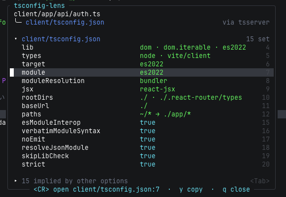

# tsconfig-lens.nvim

Which tsconfig applies to this file, and what are its final settings?



## Install

Needs Neovim >= 0.10, Node.js, and `typescript` in your project.

```lua
-- lazy.nvim
{ "harukikuri/tsconfig-lens.nvim", cmd = "TsconfigLens", opts = {} }
```

## Use

| Command | Shows |
|---|---|
| `:TsconfigLens` | tsconfig, extends chain, final options |
| `:TsconfigLens chain` | extends chain only |
| `:TsconfigLens log` | errors |

In the window: `<CR>` jump to the file and line, `<Tab>` fold a section, `y` yank, `r` refresh, `q` close.

Statusline: `require("tsconfig-lens").status()` returns the tsconfig path, `"inferred"`, or `""`.

## How it works

Your LSP finds the tsconfig. `tsc --showConfig` gives the values. The plugin only computes which line set each option, and checks that against TypeScript. If they disagree, it shows `unknown`.

More: `:help tsconfig-lens`
